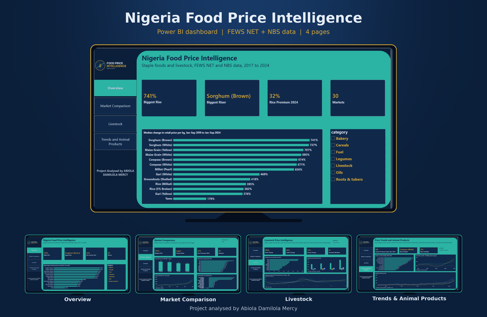
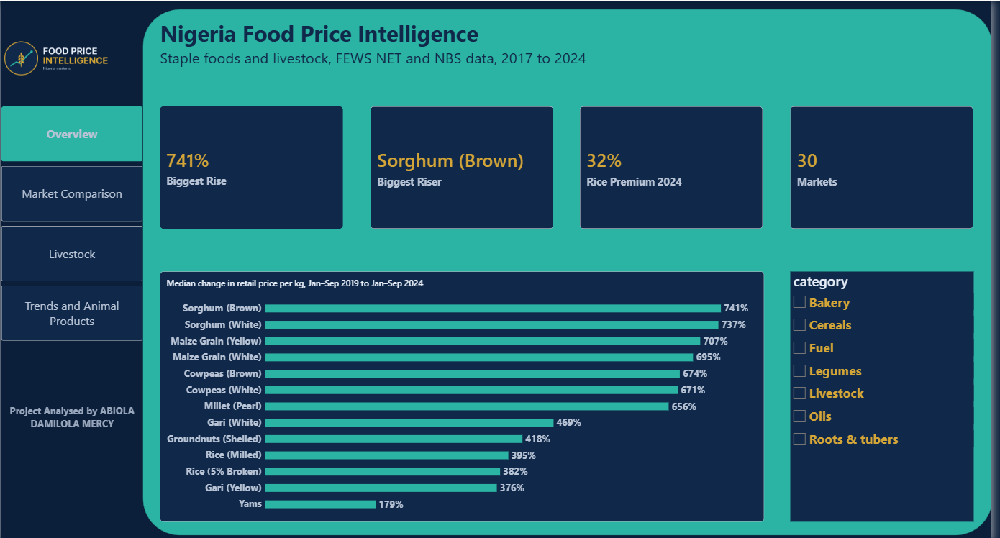
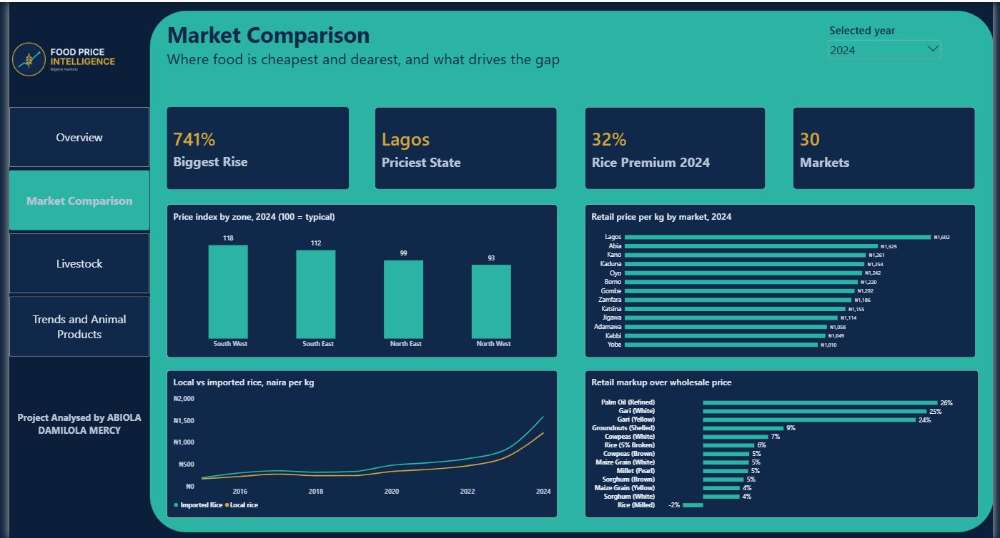
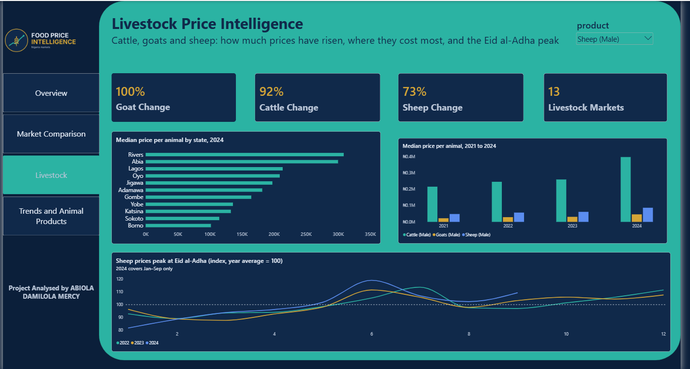
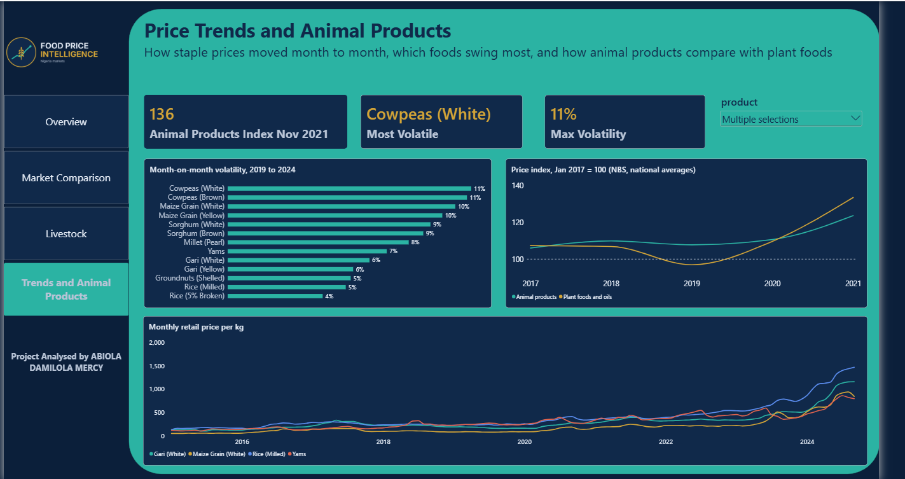

# Nigeria Agricultural Market & Food Price Intelligence

**An end-to-end analytics project on staple food and livestock prices in Nigeria, using Excel, PostgreSQL and Power BI.**




| Cleaned price records | Markets | States | Business questions | Dashboard pages |
| :---: | :---: | :---: | :---: | :---: |
| 228,381 | 30 | 15 | 12 | 4 |

## Contents
- [Project overview](#project-overview)
- [Business problem](#business-problem)
- [Project objectives](#project-objectives)
- [Dataset sources](#dataset-sources)
- [Tools and technologies](#tools-and-technologies)
- [Data cleaning methodology](#data-cleaning-methodology)
- [SQL analysis](#sql-analysis)
- [Key findings](#key-findings)
- [Business recommendations](#business-recommendations)
- [Dashboard pages](#dashboard-pages)
- [Project limitations](#project-limitations)
- [How to reproduce the project](#how-to-reproduce-the-project)
- [Author information](#author-information)

## Project overview
This project studies how the prices of staple foods and livestock have moved across Nigerian markets. It combines two public datasets (FEWS NET and NBS), cleans them in Excel, analyses them in PostgreSQL with twelve business questions, and presents the results in a four-page Power BI dashboard.

The project draws on an Animal Science background, which is why livestock prices (cattle, goats and sheep) are analysed alongside staple food prices.

## Business problem
Food and livestock prices decide what households can afford, what traders earn and when farmers should sell. Price data is available, but it is spread across large files with mixed units, gaps and outliers, which makes simple questions hard to answer:
- Which foods are becoming more expensive fastest?
- Where is the same food cheapest and where is it most expensive?
- Which foods are the most volatile, and when do livestock prices peak?

## Project objectives
1. Clean and standardise two price datasets so they can be compared fairly.
2. Answer twelve business questions on price rises, regional gaps, markups, volatility and seasonality.
3. Compare local and imported rice, and animal products with plant foods.
4. Build an interactive dashboard that a non-technical reader can use.
5. Turn the findings into practical recommendations for consumers, traders, planners and livestock farmers.

## Dataset sources
| Source | What it contains | Role |
| --- | --- | --- |
| FEWS NET Staple Food Price Data (via the Humanitarian Data Exchange) | Long-format market prices: 15 states, 30 markets, retail and wholesale, local and imported, mixed units | Core analysis |
| NBS Food Prices 2017-2021 (via openAFRICA) | National average prices: 43 items x 59 months | Supporting analysis (animal products vs plant foods) |

The two sources are never merged into one table. All prices are **nominal naira** (not adjusted for inflation). Please check each provider's terms before reusing the data; the cleaned files are included here only so the work can be reproduced.

## Tools and technologies
| Tool | Used for |
| --- | --- |
| Microsoft Excel | Cleaning, unit standardisation, outlier flags, cleaning log and checks |
| PostgreSQL 16 and pgAdmin | Loading the data and running the twelve analysis queries |
| Power BI Desktop (DAX) | Dashboard, measures and theme |
| SQL views | A tested layer between the database and Power BI |

## Data cleaning methodology
Cleaning was done in Excel and documented in a Cleaning_Log sheet, with a Checks sheet of formula tests.

- **FEWS NET:** kept from 2015 onward (earlier years are sparse); standardised mixed units to price per kg, per litre, per item or per tuber; added a state-to-zone lookup (geopolitical zones); **228,381 rows** retained, of which 7,064 are livestock.
- **Outliers:** a price is flagged if it is above 3 times or below one third of the rolling median of its own market, product, price type and unit series (a centred nine-reading window). **51 rows** were flagged; they are kept in Excel and excluded in SQL.
- **NBS:** unpivoted from a wide table (months in columns) into a long table of **2,537 rows**; added month-on-month change and a review flag for moves above 35%.
- **Checks:** eight formula checks reconcile row counts and key totals between the source, Excel and SQL; all pass.

## SQL analysis
All queries are in `sql/02_analysis_queries.sql`. Method rules: market-level monthly averages are the base; prices are only compared within the same unit; period-over-period change uses matched markets (median of market-level % change); 2024 stops in September, so comparisons use the same months in both years.

| # | Question |
| --- | --- |
| 1 | Which commodities have the highest average prices? |
| 2 | Which states and markets have the highest and lowest prices? |
| 3 | Which commodities fluctuate and swing most? |
| 4 | How do retail and wholesale prices compare? |
| 5 | Which commodities differ most between states? |
| 6 | What are the monthly price trends? |
| 7 | Which commodities rose most? |
| 8 | Which geopolitical zones are most expensive? |
| 9 | How do local and imported rice compare? |
| 10 | How fast did cattle, goat and sheep prices rise, and which states pay most? |
| 11 | Is there a seasonal pattern in livestock prices? |
| 12 | Did animal products rise faster than plant foods? (NBS) |

`sql/03_powerbi_views.sql` turns these into the views that feed the dashboard.

## Key findings
- **Biggest rise:** brown sorghum rose **741%** in retail price per kg between Jan-Sep 2019 and Jan-Sep 2024, in the markets monitored. White sorghum (737%) and yellow maize (707%) followed.
- **Livestock:** median price per head rose 100% for goats, 92% for cattle and 73% for sheep from 2021 to 2024.
- **Zones:** price index (100 = typical) is 118 in the South West, 112 in the South East, 99 in the North East and 93 in the North West.
- **State gaps:** yams cost 3.7 times more in Kano (₦1,003/kg) than in Jigawa (₦271/kg); yellow gari costs 3.4 times more in Oyo than in Kaduna.
- **Retail markup over wholesale:** 26% for palm oil and 25% for white gari, against 4-5% for most cereals.
- **Local vs imported rice:** imported 5% broken rice cost 28-44% more per kg than local milled rice in every year from 2015 to 2024 (32% in 2024).
- **Volatility:** cowpeas and maize swing most (9-11 points month on month); imported rice is steadiest.
- **Seasonality:** sheep prices peak in the month of Eid al-Adha (index 114 in Jul 2022, 112 in Jun 2023, 119 in Jun 2024; year average = 100). Cattle and goats show it less consistently.
- **Animal products vs plant foods (NBS):** animal products did not outpace plant foods. By Nov 2021, plant foods and oils reached 147 and animal products 136 (Jan 2017 = 100).

## Business recommendations
| Audience | Recommendation |
| --- | --- |
| Consumers and traders | Compare states before bulk buying, because some foods cost three times more in one state than another. |
| Consumers and traders | Prefer local milled rice over imported rice where the grade suits the use. |
| Agricultural planners | Target storage and market-access support at cowpeas, maize, sorghum and millet, which swing and rise most. |
| Agricultural planners | Look at what drives the high retail markup on palm oil and gari. |
| Livestock farmers and buyers | Plan sheep sales and purchases around Eid al-Adha. |
| Livestock farmers and buyers | Check state price gaps (for example Abia vs Borno for cattle) and transport cost before moving animals. |

## Dashboard pages
**Page 1: Overview.** Headline numbers (biggest rise, rice import premium, markets covered) and the median price change for every staple.



**Page 2: Market Comparison.** Price index by zone, retail price per kg by state, local vs imported rice and retail markup over wholesale, with a year selector.



**Page 3: Livestock.** Price change for goats, cattle and sheep, price per animal by state and by year, and the sheep price index by month showing the Eid al-Adha peak.



**Page 4: Price Trends and Animal Products.** Monthly price trends for selected staples, month-on-month volatility, and NBS price indices for animal products vs plant foods.



A PDF of all four pages is in [`reports/Food_Price_Dashboard.pdf`](reports/Food_Price_Dashboard.pdf).

## Project limitations
- FEWS NET covers 15 states, mostly in the north. The South South and North Central have no staple prices, so findings describe the markets monitored, not Nigeria as a whole.
- Prices are nominal naira, so part of every rise is general inflation.
- Each livestock state has only one or two markets; read state figures as market prices.
- 2024 holds January to September only; year-on-year comparisons use the same months.
- Livestock seasonality rests on a short run of years, so treat it as a strong pattern in this data, not a proven rule.
- The NBS data ends in 2021 and holds national averages only; FEWS and NBS levels differ (for example FEWS maize runs below NBS), so the two are compared in direction, not merged.

## How to reproduce the project
1. Unzip `data/cleaned/fews_prices_clean.csv.gz`.
2. In PostgreSQL, create a database named `food_prices`.
3. Run `sql/01_create_tables_and_import.sql` once, then import the three CSV files into their tables (pgAdmin: right-click a table, Import/Export). Do not re-run the create script after loading data.
4. Check the row counts: 15 (state_zone), 2,537 (nbs_prices), 228,381 (fews_prices).
5. Run `sql/02_analysis_queries.sql`, then `sql/03_powerbi_views.sql`.
6. In Power BI, connect to PostgreSQL and follow `powerbi/PowerBI_Build_Guide.md`. Apply `powerbi/FoodPrice_Theme.json`.

```
sql/            table creation, 12 analysis queries, Power BI views
powerbi/        theme file and build guide
data/cleaned/   cleaned workbook and CSV files
images/         dashboard preview, page screenshots and logo
reports/        PDF of the four dashboard pages
```

## Author information
**Abiola Damilola Mercy**
Data analyst based in Ibadan, Nigeria. B.Sc Animal Science (in progress), University of Ibadan.

- LinkedIn: [abiola-damilola](https://www.linkedin.com/in/abiola-damilola-b57728406)
- GitHub: [Abiola201](https://github.com/Abiola201)

Feedback and questions are welcome.
