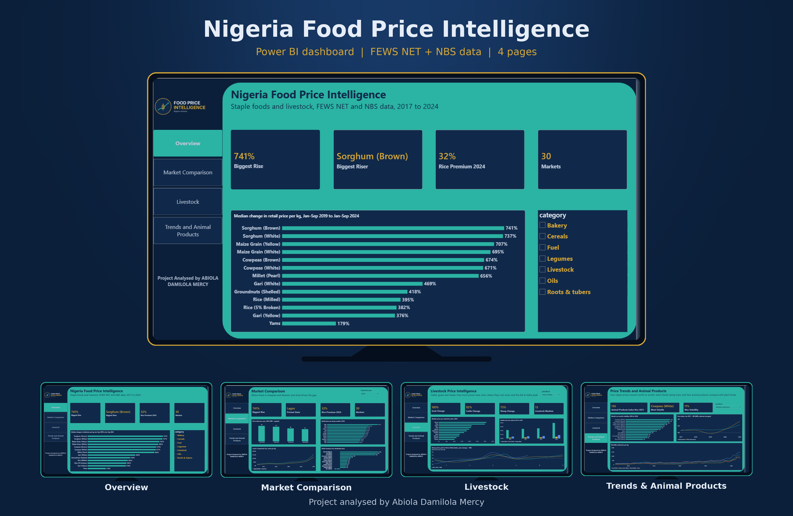

# Nigeria Agricultural Market & Food Price Intelligence



An end-to-end analytics project on staple food and livestock prices in Nigeria: **Excel** for cleaning, **PostgreSQL** for analysis, **Power BI** for the dashboard.
Built by Abiola Damilola Mercy (B.Sc Animal Science, University of Ibadan) to connect an Animal Science background with data analytics.

## What this project answers
Twelve questions on price rises, gaps between states and zones, retail vs wholesale markups, local vs imported rice, volatility, livestock seasonality, and how animal products compare with plant foods.

## Data
| Source | What it is | Used for |
| --- | --- | --- |
| [FEWS NET Staple Food Price Data](https://data.humdata.org) (via HDX) | Long-format market prices, 15 states, 30 markets, retail and wholesale | Core analysis |
| NBS Food Prices 2017-2021 (via openAFRICA) | National average prices, 43 items x 59 months | Supporting analysis (animal products vs plant foods) |

The two sources are never merged into one table. All prices are **nominal naira** (not adjusted for inflation). Please check each provider's terms before reusing the data. The cleaned files are included here so the work can be reproduced.

## Method in brief
- **Cleaning (Excel):** unit standardisation to per kg, per litre, per item or per tuber; analysis from 2015 onward; a 3x rolling-median outlier flag (51 of 228,381 rows flagged and excluded in SQL, kept in Excel).
- **Analysis (PostgreSQL):** market-level monthly averages as the base; comparisons only within the same unit; matched markets for change over time (median of market-level % change); Jan-Sep vs Jan-Sep because 2024 stops in September.
- **Dashboard (Power BI):** four pages built on tested SQL views (`sql/03_powerbi_views.sql`).

## Key findings
- **Biggest rise:** brown sorghum rose **741%** in retail price per kg between Jan-Sep 2019 and Jan-Sep 2024, in the markets monitored.
- **Livestock:** goats +100%, cattle +92%, sheep +73% from 2021 to 2024 (median price per head).
- **Zones:** price index (100 = typical) is 118 in the South West, 112 in the South East, 99 in the North East and 93 in the North West.
- **State gaps:** yams cost 3.7 times more in Kano (N1,003/kg) than in Jigawa (N271/kg).
- **Markup:** retail markup is 26% for palm oil and 25% for white gari, against 4-5% for most cereals.
- **Rice:** imported 5% broken rice cost 32% more per kg than local milled rice in 2024.
- **Volatility:** cowpeas and maize swing most (9-11 points month on month).
- **Seasonality:** sheep prices peak in the month of Eid al-Adha (index 114 in Jul 2022, 112 in Jun 2023, 119 in Jun 2024).
- **Animal vs plant (NBS):** animal products did not outpace plant foods; by Nov 2021, plant foods and oils reached 147 and animal products 136 (Jan 2017 = 100).

## Recommendations
- **Consumers and traders:** compare states before bulk buying (large price gaps) and prefer local rice where the grade suits.
- **Planners:** focus storage and market-access support on cowpeas, maize, sorghum and millet, which swing and rise most.
- **Livestock farmers and buyers:** plan sales and purchases around Eid al-Adha, and check state price gaps before moving animals.

## Limits
FEWS NET covers 15 states, mostly in the north; the South South and North Central have no staple prices. Each livestock state has only one or two markets. Large percentage rises describe the markets monitored, not Nigeria as a whole. Prices are nominal.

## Repository layout
```
sql/        01 tables and import | 02 twelve analysis queries | 03 Power BI views
powerbi/    theme file and step-by-step build guide
data/cleaned/  cleaned workbook and CSVs (fews_prices_clean.csv.gz must be unzipped before import)
images/     dashboard screenshots, PDF and logo
```

## Reproduce it
1. Unzip `data/cleaned/fews_prices_clean.csv.gz`.
2. In PostgreSQL, create a database `food_prices`, then run `sql/01_create_tables_and_import.sql` and import the three CSV files (pgAdmin Import/Export).
3. Run `sql/02_analysis_queries.sql`, then `sql/03_powerbi_views.sql`.
4. In Power BI, connect to PostgreSQL and follow `powerbi/PowerBI_Build_Guide.md`. Apply `powerbi/FoodPrice_Theme.json`.

## Tools
Excel, PostgreSQL 16, Power BI Desktop.

## Author
Abiola Damilola Mercy, Ibadan, Nigeria. Entry-level data analyst.
